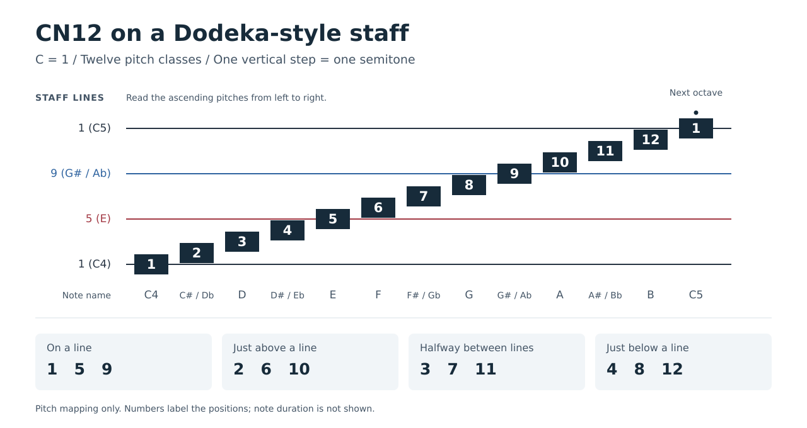

# CN12 Notation

For an exploration of harmony, voice leading, and chord progressions using
this notation, see [Music Theory in CN12](MUSIC_THEORY.md).

## Philosophy

CN12 is a chromatic music notation system designed around modern 12-tone equal temperament.

It is based on the following principles:

1. The 12 chromatic pitch classes are fundamental.
2. Enharmonic spellings are unnecessary in equal temperament.
3. Octave-equivalent notes should share visual identity.
4. Transposed musical structures should retain the same visual relationships.
5. Harmonic interpretation should be separated from pitch representation.
6. Existing rhythmic and expressive notation should be preserved whenever possible.

The system is intended primarily for equal-tempered instruments such as piano, guitar, synthesizers, and electronic instruments.

---

# Pitch Classes

The octave consists of 12 unique pitch classes.

| Number | Traditional Name |
| ------ | ---------------- |
| 1      | C                |
| 2      | C# / Db          |
| 3      | D                |
| 4      | D# / Eb          |
| 5      | E                |
| 6      | F                |
| 7      | F# / Gb          |
| 8      | G                |
| 9      | G# / Ab          |
| 10     | A                |
| 11     | A# / Bb          |
| 12     | B                |

C is `1`. The natural notes are C = `1`, D = `3`, E = `5`, F = `6`,
G = `8`, A = `10`, and B = `12`. C through E are odd; F through B are
even.

Each pitch class has exactly one symbol.

Enharmonic distinctions are collapsed.

Examples:

* A# = Bb = 11
* C# = Db = 2
* G# = Ab = 9

---

# Octaves

Pitch class and octave are represented separately.

The pitch identity remains visually constant across octaves.

Examples:

* 1 = C
* 1̇ = C one octave higher
* 1̣ = C one octave lower

The exact octave-marking convention is not finalized.

Possible implementations include:

* dots above and below (similar to Jianpu)
* superscript octave numbers
* repeated vertical staff positions

The primary requirement is that octave-related notes remain visually recognizable as the same pitch class.

---

# Intervals

Intervals are measured directly in semitones.

Examples:

| Interval    | Distance |
| ----------- | -------- |
| Minor 2nd   | 1        |
| Major 2nd   | 2        |
| Minor 3rd   | 3        |
| Major 3rd   | 4        |
| Perfect 4th | 5        |
| Tritone     | 6        |
| Perfect 5th | 7        |
| Minor 6th   | 8        |
| Major 6th   | 9        |
| Minor 7th   | 10       |
| Major 7th   | 11       |
| Octave      | 12       |

Intervals should be visually and numerically consistent across all keys.

---

# Chords

Chords are represented as pitch-class structures and interval structures.

The interval structure begins with `+0` for the root, followed by the intervals
between successive chord tones.

Examples with root `1` (C):

Major triad:

`1 5 8`

Interval structure:

`+0 +4 +3`

Minor triad:

`1 4 8`

Interval structure:

`+0 +3 +4`

Dominant seventh:

`1 5 8 11`

Interval structure:

`+0 +4 +3 +3`

Chord quality is determined by interval structure rather than note spelling.

---

# Common Chords

The following table lists commonly used chord types by interval structure.

Each structure starts with `+0`, the root. Later values are added
cumulatively. For example, `+0 +4 +3` means root, then 4 semitones above the
root, then 3 more semitones above that.

Extended chords are shown in traditional chord-tone order. When converted to
pitch classes, notes beyond the octave wrap around in the same way as keys and
scales.

| Chord Type | Common Symbol | Interval Structure |
| ---------- | ------------- | ------------------ |
| Major triad | `maj`, `M` | `+0 +4 +3` |
| Minor triad | `min`, `m` | `+0 +3 +4` |
| Diminished triad | `dim`, `°` | `+0 +3 +3` |
| Augmented triad | `aug`, `+` | `+0 +4 +4` |
| Suspended 2nd | `sus2` | `+0 +2 +5` |
| Suspended 4th | `sus4` | `+0 +5 +2` |
| Power chord | `5` | `+0 +7` |
| Major sixth | `6` | `+0 +4 +3 +2` |
| Minor sixth | `m6` | `+0 +3 +4 +2` |
| Major seventh | `maj7`, `M7` | `+0 +4 +3 +4` |
| Dominant seventh | `7` | `+0 +4 +3 +3` |
| Minor seventh | `m7` | `+0 +3 +4 +3` |
| Minor-major seventh | `m(maj7)` | `+0 +3 +4 +4` |
| Half-diminished seventh | `m7b5`, `ø` | `+0 +3 +3 +4` |
| Diminished seventh | `dim7`, `°7` | `+0 +3 +3 +3` |
| Augmented major seventh | `augmaj7`, `+maj7` | `+0 +4 +4 +3` |
| Augmented seventh | `aug7`, `7#5` | `+0 +4 +4 +2` |
| Dominant seventh flat fifth | `7b5` | `+0 +4 +2 +4` |
| Added second | `add2` | `+0 +2 +2 +3` |
| Added ninth | `add9` | `+0 +4 +3 +7` |
| Minor added ninth | `madd9` | `+0 +3 +4 +7` |
| Dominant ninth | `9` | `+0 +4 +3 +3 +4` |
| Major ninth | `maj9`, `M9` | `+0 +4 +3 +4 +3` |
| Minor ninth | `m9` | `+0 +3 +4 +3 +4` |
| Dominant eleventh | `11` | `+0 +4 +3 +3 +4 +3` |
| Minor eleventh | `m11` | `+0 +3 +4 +3 +4 +3` |
| Dominant thirteenth | `13` | `+0 +4 +3 +3 +4 +3 +4` |
| Major thirteenth | `maj13`, `M13` | `+0 +4 +3 +4 +3 +3 +4` |
| Minor thirteenth | `m13` | `+0 +3 +4 +3 +4 +3 +4` |
| Dominant seventh flat ninth | `7b9` | `+0 +4 +3 +3 +3` |
| Dominant seventh sharp ninth | `7#9` | `+0 +4 +3 +3 +5` |

---

# Keys

Keys remain valid musical concepts.

However, keys are treated as subsets of the 12 pitch classes rather than as fundamental organizational structures.

The notes of a key are calculated from its root using the interval pattern of
the key's scale. Because CN12 numbers are fixed pitch classes, the root keeps
its global pitch-class number; it is not renamed to `1`.

For example, a major key uses the following semitone offsets from its root:

`0 2 4 5 7 9 11`

The `0` includes the root itself. To calculate the notes of a major key, add
each offset to the root's pitch-class number. If a result is greater than `12`,
wrap it around by subtracting `12`.

In formula form, for root `r` and semitone offset `i`:

Pitch class:

$$
\begin{cases}
r + i, & \text{if } r + i \le 12 \\
r + i - 12, & \text{if } r + i > 12
\end{cases}
$$

For C major, the root is C = `1`:

| Calculation | Pitch Class |
| ----------- | ----------- |
| 1 + 0 | 1 |
| 1 + 2 | 3 |
| 1 + 4 | 5 |
| 1 + 5 | 6 |
| 1 + 7 | 8 |
| 1 + 9 | 10 |
| 1 + 11 | 12 |

C major:

`1 3 5 6 8 10 12`

For A major, the root is A = `10`:

| Calculation | Pitch Class |
| ----------- | ----------- |
| 10 + 0 | 10 |
| 10 + 2 | 12 |
| 10 + 4 - 12 | 2 |
| 10 + 5 - 12 | 3 |
| 10 + 7 - 12 | 5 |
| 10 + 9 - 12 | 7 |
| 10 + 11 - 12 | 9 |

A major:

`10 12 2 3 5 7 9`

Other key types are calculated in the same way using one of the scale patterns
listed below. This makes a key a transposition of a reusable pitch-class
pattern. Changing the root changes the resulting pitch classes, while the
intervals from the root remain unchanged.

No key signatures are required.

---

# Common Scales

The following table lists commonly used scale patterns in semitones.

**Offsets from root** gives the distance of every note from the root. The root
is always `0`. These are the values added to the root pitch class when
calculating the notes of a scale.

**Step pattern** gives the distance between consecutive notes. Its final value
is the step from the last note back to the root one octave higher.

| Scale | Offsets from Root | Step Pattern |
| ----- | ----------------- | ------------ |
| Major (Ionian) | `0 2 4 5 7 9 11` | `2 2 1 2 2 2 1` |
| Dorian | `0 2 3 5 7 9 10` | `2 1 2 2 2 1 2` |
| Phrygian | `0 1 3 5 7 8 10` | `1 2 2 2 1 2 2` |
| Lydian | `0 2 4 6 7 9 11` | `2 2 2 1 2 2 1` |
| Mixolydian | `0 2 4 5 7 9 10` | `2 2 1 2 2 1 2` |
| Natural minor (Aeolian) | `0 2 3 5 7 8 10` | `2 1 2 2 1 2 2` |
| Locrian | `0 1 3 5 6 8 10` | `1 2 2 1 2 2 2` |
| Harmonic minor | `0 2 3 5 7 8 11` | `2 1 2 2 1 3 1` |
| Melodic minor (ascending) | `0 2 3 5 7 9 11` | `2 1 2 2 2 2 1` |
| Harmonic major | `0 2 4 5 7 8 11` | `2 2 1 2 1 3 1` |
| Major pentatonic | `0 2 4 7 9` | `2 2 3 2 3` |
| Minor pentatonic | `0 3 5 7 10` | `3 2 2 3 2` |
| Blues | `0 3 5 6 7 10` | `3 2 1 1 3 2` |
| Whole-tone | `0 2 4 6 8 10` | `2 2 2 2 2 2` |
| Diminished (whole-half) | `0 2 3 5 6 8 9 11` | `2 1 2 1 2 1 2 1` |
| Diminished (half-whole) | `0 1 3 4 6 7 9 10` | `1 2 1 2 1 2 1 2` |
| Chromatic | `0 1 2 3 4 5 6 7 8 9 10 11` | `1 1 1 1 1 1 1 1 1 1 1 1` |

In traditional practice, the descending melodic minor scale commonly uses the
natural minor pattern.

---

# All Major and Natural Minor Scales

Each row pairs a major scale with its relative natural minor. They share
the same pitch classes but start from different roots: the relative minor
starts on the sixth note of the major scale, `9` semitones above its root
(or `3` semitones below). Wrap the root number into `1` through `12`.

Major uses root offsets `0 2 4 5 7 9 11`; natural minor uses
`0 2 3 5 7 8 10` from its own root. Traditional root names are included
for reference; names separated by `/` identify the same CN12 pitch class.

The notes are in ascending scale order, wrapping after `12`. A smaller
number after a wrap represents a higher note, not a downward movement.
The repeated root at the next octave is omitted.

| Major Root | Root Note Name | Major Scale | Relative Minor Root | Minor Root Note Name | Relative Natural Minor Scale |
| ---------- | -------------- | ----------- | ------------------- | -------------------- | ---------------------------- |
| `1` | C | `1 3 5 6 8 10 12` | `10` | A | `10 12 1 3 5 6 8` |
| `2` | C# / Db | `2 4 6 7 9 11 1` | `11` | A# / Bb | `11 1 2 4 6 7 9` |
| `3` | D | `3 5 7 8 10 12 2` | `12` | B | `12 2 3 5 7 8 10` |
| `4` | D# / Eb | `4 6 8 9 11 1 3` | `1` | C | `1 3 4 6 8 9 11` |
| `5` | E | `5 7 9 10 12 2 4` | `2` | C# / Db | `2 4 5 7 9 10 12` |
| `6` | F | `6 8 10 11 1 3 5` | `3` | D | `3 5 6 8 10 11 1` |
| `7` | F# / Gb | `7 9 11 12 2 4 6` | `4` | D# / Eb | `4 6 7 9 11 12 2` |
| `8` | G | `8 10 12 1 3 5 7` | `5` | E | `5 7 8 10 12 1 3` |
| `9` | G# / Ab | `9 11 1 2 4 6 8` | `6` | F | `6 8 9 11 1 2 4` |
| `10` | A | `10 12 2 3 5 7 9` | `7` | F# / Gb | `7 9 10 12 2 3 5` |
| `11` | A# / Bb | `11 1 3 4 6 8 10` | `8` | G | `8 10 11 1 3 4 6` |
| `12` | B | `12 2 4 5 7 9 11` | `9` | G# / Ab | `9 11 12 2 4 5 7` |

---

# Harmonic Function

Pitch representation and harmonic interpretation are separate concepts.

The notation encodes:

* pitch class
* octave
* rhythm

The notation does not inherently encode:

* leading tones
* dominant function
* secondary dominants
* modulation analysis

Such information may be provided through optional analytical annotations.

---

# Rhythm and Expression

CN12 does not modify existing rhythmic notation.

The following elements are preserved:

* note durations
* stems
* beams
* rests
* ties
* slurs
* dynamics
* articulations
* fingering indications

Only pitch representation is modified.

---

# Visual Layout

The exact visual layout is not finalized.

Current candidates include:

1. [Dodeka-style chromatic staff](https://chromatone.center/theory/notes/alternative/dodeka/).
   Dodeka places the twelve pitches on a four-line staff, with distinct
   positions on, just above, halfway between, and just below the lines.
2. [Jianpu-style numeric notation: an introduction](https://www.guitar-pro.com/docs/gp8/score/note/jianpu).

Any layout must satisfy:

* octave equivalence is visually obvious
* all 12 pitch classes are represented uniquely
* transposed patterns retain similar appearance
* polyphonic music remains readable

The visual system is considered separate from the underlying pitch representation.

## Dodeka Staff Mapping

This diagram adds CN12 numbers to Dodeka's pitch positions. From bottom to
top, the four lines mark `1` (C), `5` (E), `9` (G# / Ab), and `1` (C in
the next octave). Each upward step is one semitone.

The dot above the final `1` marks the next octave. Letter names below the
staff are lookup labels. This is a pitch-mapping study, not a rhythm example
or a finalized CN12 score layout. Dodeka's own note lengths and rhythm symbols
are separate from CN12's proposed use of conventional rhythm notation.

Pitch positions follow [Dodeka's reading guide](https://dodekamusic.com/company/dodeka-blog/how-to-read-dodeka-sheet-music/).
The [SVG diagram](assets/cn12-dodeka-mapping.svg) can be opened separately
and enlarged without losing detail.
